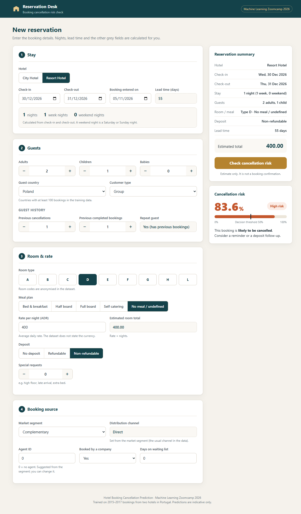
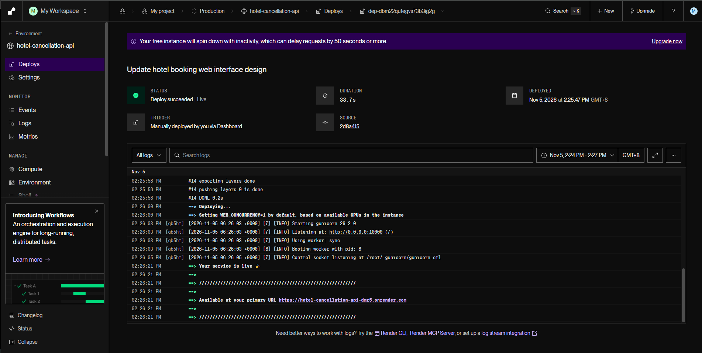
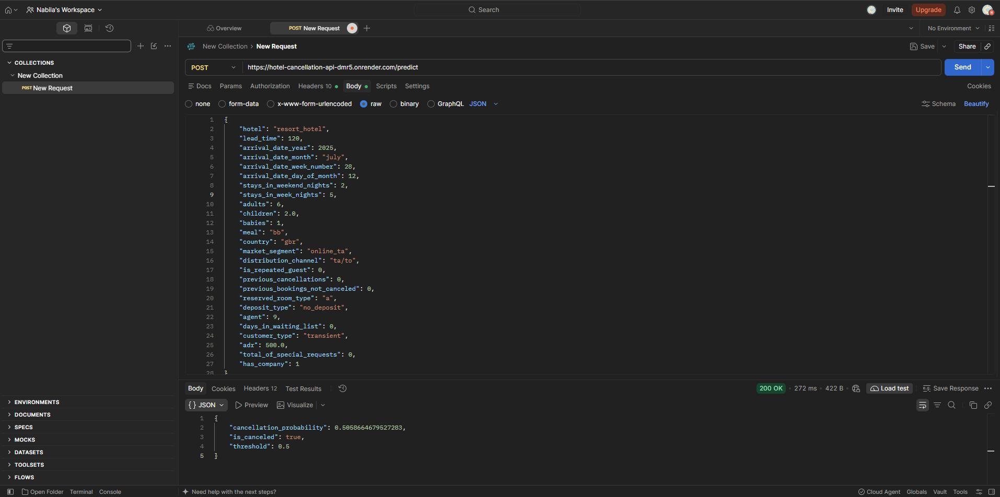
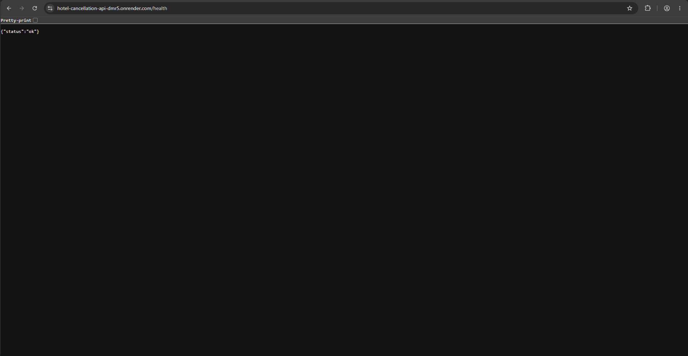
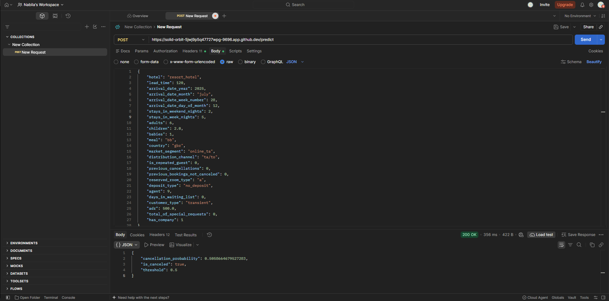

# Hotel Booking Cancellation Prediction

## Project Overview

This project develops an end-to-end machine learning application that estimates the probability of a hotel booking being cancelled.

The project demonstrates a complete machine learning workflow, including exploratory data analysis (EDA), data cleaning, feature engineering, model development, hyperparameter tuning, model evaluation, prediction, API development, web application development, automated testing, Docker containerization and cloud deployment.

**Project status**

| Component | Status |
|---|---|
| Data audit, cleaning and EDA | Completed |
| Feature engineering and model development | Completed |
| Hyperparameter tuning and model evaluation | Completed |
| Saved XGBoost model artifact | Completed |
| Flask prediction API | Completed |
| Interactive web application | Completed |
| Automated API testing | Completed |
| Docker containerization | Completed |
| Cloud deployment using Render | Completed |

## Quick Start for Reviewers

| I want to... | Go to |
|---|---|
| Try the live app | https://hotel-cancellation-api-dmr5.onrender.com/ (free tier: the first load after inactivity can take about 1 minute) |
| Read the data analysis | `notebooks/01_eda_cleaning.ipynb` |
| Read the model comparison and tuning | `notebooks/02_modeling.ipynb` |
| Run the project locally | [Reproducibility](#reproducibility-running-the-project-locally) |
| Run the Docker container | [Docker Containerization](#docker-containerization) |

Fastest local check (the install takes a few minutes):

```bash
git clone https://github.com/nabila-natasha/hotel-booking-cancellation-ml.git
cd hotel-booking-cancellation-ml
python -m venv .venv
source .venv/bin/activate          # Windows PowerShell: .\.venv\Scripts\Activate.ps1
pip install -r requirements.txt
python -m pytest tests -v          # expected: 2 passed
python src/app.py                  # then open http://127.0.0.1:9696/
```

## Business Problem

Hotel cancellations affect room availability, revenue planning and operational decisions.

A cancellation-risk model could help a hotel's revenue-management team identify bookings that may require attention. Potential actions include sending booking reminders, reviewing deposit policies or planning room availability more carefully.

**Project objective:** Develop a machine learning model that estimates cancellation probability using hotel booking information available to the prediction application.

The application provides:
- An estimated cancellation probability.
- A predicted cancellation status.
- A configurable classification threshold stored with the model artifact.

Predictions are estimates, not guarantees, and should not be the sole basis for decisions affecting customers.

## Live Application

The application is deployed on Render and can be accessed publicly.

**Live web application:**  
https://hotel-cancellation-api-dmr5.onrender.com/

Available endpoints:

| Endpoint | Method | Description |
|---|---|---|
| `/` | GET | Interactive hotel booking prediction form |
| `/health` | GET | Application health check |
| `/predict` | POST | JSON-based cancellation prediction |
| `/booking-prediction` | POST | Form submission used by the web page (open `/` to use the form) |

The web interface allows users to enter hotel booking information and submit it to the trained model. The application displays the estimated cancellation probability and predicted booking status.

The JSON API remains available for programmatic predictions and integration with other applications.

## Dataset

- **Dataset:** Hotel Booking Demand.
- **Source:** TidyTuesday, 11 February 2020.
- **Original research:** Antonio, Almeida and Nunes (2019), *Hotel booking demand datasets*, Data in Brief, 22, 41–49.
- **Hotels:** One city hotel and one resort hotel in Portugal.
- **Prediction target:** `is_canceled` (1 = cancelled, 0 = not cancelled).
- **Raw dataset:** 119,390 rows and 32 columns.
- **Cleaned dataset:** 84,392 rows and 27 columns.

| File | Description |
|---|---|
| `data/raw/hotels.csv` | Original dataset |
| `data/processed/hotels_clean.csv` | Cleaned dataset used for modelling |

If the raw dataset is unavailable, the first notebook downloads it from the TidyTuesday repository.

## Data Cleaning Decisions

The decisions below are documented with supporting analysis in `notebooks/01_eda_cleaning.ipynb`.

| Issue | Finding | Decision |
|---|---|---|
| Outcome leakage | `reservation_status` matches the target; `reservation_status_date` is recorded after the outcome | Dropped both columns |
| Information recorded after booking | `booking_changes`, `assigned_room_type` and `required_car_parking_spaces` may contain information unavailable at the intended prediction point | Dropped these columns |
| Duplicate rows | Approximately 34,000 exact duplicates after removing leakage and post-booking columns | Removed duplicates, keeping the first occurrence |
| Missing `company` values | Approximately 94% missing | Created `has_company` as a binary feature and dropped the original column |
| Missing `agent` values | Approximately 14% missing | Filled with `0` and treated as a categorical feature |
| Missing `country` and `children` values | Small number of missing values | Filled with `"unknown"` and `0`, respectively |
| Invalid or extreme values | Invalid guest counts, zero-night stays, negative prices or extreme values | Removed affected records |

## Exploratory Data Analysis: Key Findings

- 27.9% of the cleaned bookings were cancelled. Always predicting "not cancelled" gives 72.1% accuracy but finds no cancellations.
- **Hotel:** the city hotel has a higher cancellation rate (30.4%) than the resort hotel (23.9%).
- **Lead time:** cancellations rise steadily with lead time, from 8.6% for bookings made 0-7 days ahead to 40.9% for bookings made more than 180 days ahead.
- **Special requests:** bookings with no special requests are cancelled more often (34.0%) than bookings with one (22.7%) or two or more (20.4%).
- **Booking channel:** online travel agent bookings are cancelled most often (35.5%); direct (14.8%) and corporate (12.2%) bookings least.
- **Guest history:** repeat guests rarely cancel (8.3% vs 28.7%), but guests who cancelled before cancel again often (67.5% vs 27.1%).
- **Deposit type:** non-refundable bookings are cancelled 95.0% of the time (991 bookings). This is a surprising pattern and is discussed in the limitations.
- Leakage columns (for example `reservation_status`) and columns recorded after the booking were removed before modelling.

(See the EDA sections of `notebooks/01_eda_cleaning.ipynb` for the charts and tables behind these findings.)

## Machine Learning Workflow

The project follows these steps:

1. Data audit, cleaning and exploratory data analysis.
2. Stratified train, validation and test split (60/20/20).
3. Feature preprocessing using `DictVectorizer`.
4. Training and tuning four model types: logistic regression, decision tree, random forest and XGBoost.
5. Comparing the models on the validation set using ROC-AUC and selecting XGBoost.
6. XGBoost hyperparameter tuning using 5-fold cross-validation.
7. Final evaluation on the held-out test set using ROC-AUC, precision and recall.
8. Saving the trained model and preprocessing object.
9. Loading the saved artifact for individual booking predictions.
10. Developing a Flask REST API.
11. Building an interactive Flask web interface.
12. Automated API testing with pytest.
13. Docker containerization.
14. Cloud deployment using Render.

### Model and Training

The selected model uses XGBoost with a binary logistic objective.

The training script saves the following objects together:

- Trained XGBoost model.
- Fitted `DictVectorizer`.
- Classification threshold.

The saved artifact is located at:

`models/xgboost_model.bin`

The prediction application loads this artifact at startup. It does not retrain the model for each prediction or when the application starts.

### Model Comparison

Four model types were trained on the same training data and compared on the validation set. Each model was tuned over a small set of hyperparameters.

| Model | Tuned hyperparameters | Best setting | Validation ROC-AUC |
|---|---|---|---|
| **XGBoost** | `eta`, `max_depth`, `min_child_weight`, `subsample`, `colsample_bytree` (5-fold CV) | eta 0.1, max_depth 8, min_child_weight 1, subsample 0.8, colsample_bytree 0.8, 223 rounds | **0.8979** |
| Random forest | `n_estimators`, `max_depth` | 300 trees, max_depth 25 | 0.8768 |
| Decision tree | `max_depth`, `min_samples_leaf` | max_depth 10, min_samples_leaf 20 | 0.8728 |
| Logistic regression | `C` | C = 10 | 0.8061 |

XGBoost has the highest validation ROC-AUC, so it was selected as the final model. It was then retrained on the training and validation data and evaluated once on the test set.

### Results

| Measure | Value |
|---|---|
| Test ROC-AUC (notebook) | 0.9039 |
| Test ROC-AUC (`src/train.py`) | 0.9045 |
| Test PR-AUC | 0.7898 |
| Precision at threshold 0.5 | 0.743 |
| Recall at threshold 0.5 | 0.643 |
| F1 at threshold 0.5 | 0.689 |
| Accuracy at threshold 0.5 | 0.838 (always predicting "not cancelled" gives 0.721) |

All values in the first table come from `notebooks/02_modeling.ipynb` (final model trained on the training and validation data, evaluated once on the test set), except the `src/train.py` row.

The notebook (0.9039) and `src/train.py` (0.9045) differ slightly because the notebook uses `agent` as a number, while `train.py` treats it as a text category (it is an ID). The deployed model is the one trained by `src/train.py`. Retraining also gives slightly different values because XGBoost uses random subsampling.

### Threshold

The selected classification threshold is 0.5. At this threshold about 74% of the bookings flagged as "likely to cancel" are really cancelled (precision), and about 64% of all cancellations are found (recall). A lower threshold finds more cancellations but raises more false alarms (for example at 0.3: recall about 0.83, precision about 0.63). A hotel can change the threshold stored in the model artifact to match its own costs.

Detailed modelling experiments and evaluation are documented in `notebooks/02_modeling.ipynb`.

## Interactive Web Application

The Flask application provides a browser-based interface for entering hotel booking information.

The form follows a hotel reservation layout with four sections and a live reservation summary:

1. **Stay:** hotel, check-in, check-out and booking entry date.
2. **Guests:** adults, children, babies, country, customer type and guest history.
3. **Room and rate:** room type, meal plan, rate per night, deposit and special requests.
4. **Booking source:** market segment, agent, company booking and waiting-list days.

Some values are calculated automatically, so users do not enter them:

| Calculated value | How it is calculated |
|---|---|
| Number of nights, weekend nights and week nights | From check-in and check-out (a weekend night is a Saturday or Sunday night) |
| Lead time | Check-in date minus booking entry date |
| Repeat guest | Yes if the guest has any previous bookings or cancellations |
| Distribution channel | The usual channel for the chosen market segment in the training data |
| Estimated room total | Rate per night multiplied by the number of nights |
| Arrival year, month, week number and day | From the check-in date (done by the backend) |

The form keeps its values after a prediction and checks the dates before submitting.

### Lead Time Calculation

Lead time represents the number of days between the date a booking is entered into the property management system and the guest's arrival date.

The application accepts both dates and calculates lead time automatically:

`lead_time = arrival_date - booking_date`

The backend calculates this value again before passing the booking information to the model.

### Average Daily Rate (ADR)

The application shows ADR as a rate-per-night field.

ADR represents the average lodging revenue per occupied night. The dataset does not state the currency, so the interface shows no currency symbol.

### Prediction Result

After submitting the form, the application displays:

- Estimated cancellation probability, with a bar showing the decision threshold.
- Risk level (low or high).
- Classification threshold.

The predicted class is determined by comparing the estimated probability with the stored threshold.

## Prediction API

The Flask application exposes two API endpoints in addition to the interactive homepage.

| Endpoint | Method | Description |
|---|---|---|
| `/health` | GET | Checks whether the application is running |
| `/predict` | POST | Accepts booking information as JSON and returns a prediction |

Example request (the same booking as `test_data/booking_02.json`):

```json
{
    "hotel": "resort_hotel",
    "lead_time": 120,
    "arrival_date_year": 2025,
    "arrival_date_month": "july",
    "arrival_date_week_number": 28,
    "arrival_date_day_of_month": 12,
    "stays_in_weekend_nights": 2,
    "stays_in_week_nights": 5,
    "adults": 6,
    "children": 2.0,
    "babies": 1,
    "meal": "bb",
    "country": "gbr",
    "market_segment": "online_ta",
    "distribution_channel": "ta/to",
    "is_repeated_guest": 0,
    "previous_cancellations": 0,
    "previous_bookings_not_canceled": 0,
    "reserved_room_type": "a",
    "deposit_type": "no_deposit",
    "agent": 9,
    "days_in_waiting_list": 0,
    "customer_type": "transient",
    "adr": 500.0,
    "total_of_special_requests": 0,
    "has_company": 1
}
```

Example response for this request (the exact probability can differ slightly if the model is retrained):

```json
{
    "cancellation_probability": 0.5058664679527283,
    "is_canceled": true,
    "threshold": 0.5
}
```

The probability represents the model's estimated cancellation risk. The Boolean prediction is determined by comparing the probability with the selected threshold.

## Project Files

| File | Purpose |
|---|---|
| `notebooks/01_eda_cleaning.ipynb` | Data audit, cleaning decisions, EDA; writes `data/processed/hotels_clean.csv` |
| `notebooks/02_modeling.ipynb` | Train/validation/test split, model comparison, tuning, final evaluation |
| `src/train.py` | The final training steps from notebook 02 as a script: same split (`random_state=42`), same preprocessing and XGBoost parameters; saves `models/xgboost_model.bin` |
| `src/predict.py` | Loads the saved artifact and predicts for one booking |
| `src/predict-test.py` | Sends an example booking through the prediction code |
| `src/app.py` | Flask app: web form, `/predict` API and `/health` |
| `tests/test_app.py` | pytest tests for `/health` and `/predict` |
| `requirements.txt` | All packages for notebooks, training, app and tests (exact versions) |
| `requirements-api.txt` | Only the packages needed to run the app; used by the Dockerfile to keep the image small |
| `Dockerfile` | Builds the container image used locally and on Render |

## Repository Structure

```text
hotel-booking-cancellation-ml/
│
├── data/
│   ├── raw/
│   │   └── hotels.csv
│   └── processed/
│       └── hotels_clean.csv
│
├── models/
│   └── xgboost_model.bin
│
├── notebooks/
│   ├── 01_eda_cleaning.ipynb
│   └── 02_modeling.ipynb
│
├── src/
│   ├── train.py
│   ├── predict.py
│   ├── predict-test.py
│   ├── app.py
│   ├── templates/
│   │   └── index.html
│   └── static/
│       └── style.css
│
├── tests/
│   └── test_app.py
│
├── test_data/
│   ├── booking_01.json
│   └── booking_02.json
│
├── screenshots/
│   ├── 01-homepage.png
│   ├── 02-render-deployment.PNG
│   ├── 03-postman-prediction.PNG
│   ├── 04-health-check.PNG
│   └── 05-docker-postman-prediction.PNG
│
├── README.md
├── requirements.txt
├── requirements-api.txt
├── Dockerfile
├── .dockerignore
└── .gitignore
```

## Reproducibility: Running the Project Locally

The following instructions allow another developer or reviewer to reproduce the application locally.

### 1. Clone the repository

```bash
git clone https://github.com/nabila-natasha/hotel-booking-cancellation-ml.git

cd hotel-booking-cancellation-ml
```

### 2. Create and activate a virtual environment

This project was developed and tested with Python 3.14.2 in GitHub Codespaces, and the Docker image also uses Python 3.14. The pinned packages in `requirements.txt` also install and pass the tests on Python 3.13. Use Python 3.13 or newer.

**Windows PowerShell**

```powershell
python -m venv .venv

.\.venv\Scripts\Activate.ps1
```

**Linux / macOS / GitHub Codespaces**

```bash
python -m venv .venv

source .venv/bin/activate
```

### 3. Install dependencies

For the full project, including notebooks and development dependencies:

```bash
python -m pip install --upgrade pip

pip install -r requirements.txt
```

For the prediction application only:

```bash
pip install -r requirements-api.txt
```

The `.venv` directory is excluded from version control. Each user should create their own environment.

### 4. Run the notebooks

From the project root:

```bash
jupyter notebook
```

Run the notebooks in order:

1. `notebooks/01_eda_cleaning.ipynb` — data cleaning and EDA.
2. `notebooks/02_modeling.ipynb` — model development, evaluation and tuning.

The cleaned dataset is available under `data/processed/`, so the modelling notebook can also be run independently if that file is present.

Run time: notebook 01 takes about 15 seconds and notebook 02 takes about 10-15 minutes (cross-validation and the random forest are the slow parts).

**Running the notebooks in GitHub Codespaces or from the downloaded ZIP:** open the project folder, create the virtual environment, install `requirements.txt`, and select the `.venv` kernel. The notebooks use relative paths (`../data/...`), so they must be run from the `notebooks/` folder, which is the default in Jupyter.

**Running the notebooks in Google Colab:** uncomment the first code cell of each notebook (`!git clone ...` and `%cd ...`) and run it first. Colab has its own pre-installed package versions, so also run `%pip install xgboost==3.4.1` if XGBoost is missing. Colab shows text columns with the dtype `object`, while the pinned pandas version shows `str`. The notebooks check for non-numeric columns instead of a specific dtype, so they work with both. Running notebook 01 with pandas 2.2 (which shows `object`) and with the pinned pandas 3.1 produced an identical `hotels_clean.csv`.

### 5. Train the model (optional)

If you want to reproduce model training:

```bash
python src/train.py
```

This trains the model and saves the resulting artifact to:

```text
models/xgboost_model.bin
```

The existing saved artifact can be used to run the application without retraining, provided it is present in the repository.

Retraining overwrites `models/xgboost_model.bin`. XGBoost uses random subsampling, so a retrained model can give slightly different probabilities (in the later decimals) from the numbers shown in this README, and a booking close to the 0.5 threshold could change class. This is expected. To restore the original model, run:

```bash
git checkout models/xgboost_model.bin
```

### 6. Run the Flask application

From the project root:

```bash
python src/app.py
```

Open the application in your browser:

http://127.0.0.1:9696/

The application provides the interactive booking form and prediction result.

### 7. Check the health endpoint

Open another terminal and run:

```bash
curl http://127.0.0.1:9696/health
```

Expected response:

```json
{
  "status": "ok"
}
```

### 8. Submit a booking prediction through the API

Using the example booking JSON file:

**Windows PowerShell**

```powershell
curl.exe -X POST http://127.0.0.1:9696/predict `
  -H "Content-Type: application/json" `
  --data-binary "@test_data/booking_02.json"
```

**Linux / macOS / GitHub Codespaces**

```bash
curl -X POST http://127.0.0.1:9696/predict \
  -H "Content-Type: application/json" \
  --data-binary "@test_data/booking_02.json"
```

The API returns the cancellation probability, predicted class and classification threshold. With the saved model in this repository, `booking_02.json` returns:

```json
{
  "cancellation_probability": 0.5058664679527283,
  "is_canceled": true,
  "threshold": 0.5
}
```

### 9. Run automated tests

From the project root:

```bash
python -m pytest tests -v
```

Expected result: `2 passed`.

The tests cover:

- Health endpoint response.
- Prediction endpoint response and basic output validation.

## Docker Containerization

The application is packaged using Docker to provide a reproducible runtime environment.

The `Dockerfile` does the following:

1. Starts from the `python:3.14-slim` base image.
2. Installs the packages in `requirements-api.txt`.
3. Copies `src/` (the app) and `models/` (the trained model) into the image.
4. Starts the app with Gunicorn on the port given by the `PORT` environment variable (Render sets it), or 9696 when it is not set.

The Docker image includes:

- Python runtime.
- Application dependencies.
- Flask application.
- HTML templates and CSS.
- Saved XGBoost model artifact.

### 1. Build the Docker image

From the project root:

```bash
docker build -t hotel-cancellation-app:latest .
```

### 2. Run the Docker container

```bash
docker run --rm -p 9696:9696 hotel-cancellation-app:latest
```

The application runs inside the container using Gunicorn as its production WSGI server.

### 3. Access the application

Open:

http://localhost:9696/

For GitHub Codespaces, open the forwarded port `9696` from the Ports tab and use the generated browser URL instead of `127.0.0.1`.

### 4. Test the Dockerized API using Postman

The Dockerized application was built and tested in GitHub Codespaces (Docker 29.9.2) and called through Postman using the forwarded port.

**Request configuration:**

| Setting | Value |
|---|---|
| Method | POST |
| Endpoint | `/predict` |
| Header | `Content-Type: application/json` |
| Body | Raw JSON booking information |

The same booking payload was also tested using the local Python prediction script:

```bash
python src/predict-test.py
```

The Docker API returned the following response:

```json
{
  "cancellation_probability": 0.5058664679527283,
  "is_canceled": true,
  "threshold": 0.5
}
```

The prediction probability, classification result and threshold matched the local Python prediction exactly. This confirmed consistent inference between the local Python environment and the Docker container.

## Cloud Deployment: Render

The Dockerized Flask application is deployed as a Render Web Service.

**Deployment platform:** Render  
**Service name:** `hotel-cancellation-api`  
**Public application URL:** https://hotel-cancellation-api-dmr5.onrender.com/

| Render setting | Value |
|---|---|
| Service type | Web Service |
| Runtime | Docker (uses the repository `Dockerfile`) |
| Branch | `main` |
| Instance type | Free |
| Start command | From the Dockerfile (`gunicorn`) |

### Deployment workflow

1. Commit and push application changes to the GitHub `main` branch.
2. Render retrieves the latest repository version.
3. Render builds the application using the repository Dockerfile.
4. Gunicorn starts the Flask application inside the container.
5. The public application becomes accessible through the Render URL.

### Verify the deployed application

**Homepage**

https://hotel-cancellation-api-dmr5.onrender.com/

**Health check**

https://hotel-cancellation-api-dmr5.onrender.com/health

The health endpoint should return:

```json
{
  "status": "ok"
}
```

**Prediction**

Submit a booking through the public web interface and verify that the estimated cancellation probability and predicted status are displayed.

Render free services may spin down after periods of inactivity, so the first request after inactivity can take longer to respond.

## Model Prediction Consistency Validation

The application was tested with local Python execution, Docker containerization and the Render deployment to verify that the same booking information produces
consistent predictions across environments.

### Test Scenario

The same 26-feature hotel booking payload (`test_data/booking_02.json`) was used for all three tests.

The test booking produced the following result:

| Metric | Result |
|---|---|
| Cancellation probability | 0.5058664679527283 |
| Predicted cancellation status | True |
| Classification threshold | 0.5 |

### Validation Environments

| Environment | Test Method | Result |
|---|---|---|
| Local Python | `python src/predict-test.py` | Passed |
| Docker | Postman POST request to `/predict` | Passed |
| Render | Postman POST request to `/predict` (screenshot 3) | Passed |

The local Python, Docker and Render predictions returned identical cancellation probabilities, classification results and thresholds. All three use the same saved model file, so identical results are expected.


## Screenshots and Deployment Evidence

The following screenshots demonstrate the interactive web application,
Docker API testing, successful cloud deployment, prediction results
and application health check.

### 1. Interactive Web Application

The homepage provides an interactive form for entering hotel booking information.



### 2. Render Cloud Deployment

The Render dashboard confirms that the application has been successfully deployed.



### 3. Prediction API

A successful Postman request to the live Render URL (`/predict`) demonstrates that the deployed API accepts booking information and returns a cancellation probability (0.5058664679527283) and predicted status.



### 4. Application Health Check

The health endpoint confirms that the deployed application is responding successfully.



### 5. Docker API Prediction Test

A successful Postman POST request to the Dockerized application, running through the forwarded GitHub Codespaces port, demonstrates that the container can process booking information and return a prediction.

The prediction was also compared with the local Python execution result. Both environments returned the same cancellation probability and predicted classification.




**Live application:** https://hotel-cancellation-api-dmr5.onrender.com/


## Limitations

- The dataset contains historical bookings from two hotels in Portugal between 2015 and 2017. It may not reflect current demand or customer behaviour.
- The model uses the arrival year as a feature. It only saw the years 2015-2017, so predictions for arrival dates in later years are extrapolations and should be treated as indicative only.
- The country list in the web form only includes countries with at least 100 bookings in the training data. Other countries can be entered as "Other / not listed".
- Model performance on historical data does not guarantee performance on future bookings.
- The dataset does not contain a booking ID, so duplicates are identified using identical column values. Some identical records may represent separate real bookings.
- `total_of_special_requests` may be updated after the original booking is created. Its availability must be considered when defining the actual prediction point.
- Non-refundable bookings have a very high cancellation rate in this dataset. This relationship requires further investigation before operational interpretation.
- Model calibration, threshold selection and performance on new data would need further evaluation before real-world use.
- The application is a portfolio and learning project, not a production-validated hotel decision system.

## Author

Developed as a machine learning portfolio project for the [DataTalks.Club Machine Learning Zoomcamp](https://github.com/DataTalksClub/machine-learning-zoomcamp), as part of the midterm project.
